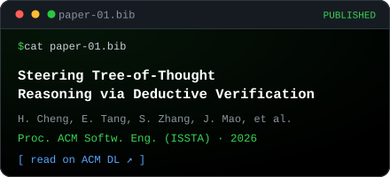
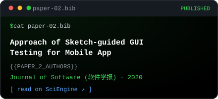

<!-- ============================================================================
     GitHub Profile README - academic edition, black-terminal theme
     ----------------------------------------------------------------------------
     LANGUAGE SWITCH
       English is expanded by default, 中文 lives in the second 
 block.
       GitHub strips JavaScript and CSS from READMEs, so 
/

       is the only reliable way to build a language toggle: click a badge.
     STRUCTURE
       prose sections (whoami / research / publications / news) are duplicated in
       both languages. The dashboard sections (projects / stats / contributions /
       stack) live once, below the toggle, with bilingual captions - every extra
       copy costs another request to a third-party card service, and those
       services rate-limit aggressively.
     PLACEHOLDERS
       Every {{PLACEHOLDER}} must be replaced before publishing.
       Full checklist + service list + config steps: PROFILE_SETUP.md
     ASSETS
       assets/banner.svg                 hero banner
       assets/cards/paper-*.svg          publication cards (edit text in the SVG)
       assets/cards/more-papers.svg      "all publications" card
       assets/contribution-graph.svg     regenerated daily by contributions.yml
     NOTE
       Inline code uses <code>...</code> rather than backticks so the file stays
       trivially greppable and sed-able. Both render identically on GitHub.
     ============================================================================ -->

  

<!-- shared contact row: language-neutral, so it is not duplicated -->

  
  
  
  
  

## <code>$ whoami</code>

> **PhD Candidate** &middot; Nanjing University
> Research focus: **AI Agent** &middot; Software Engineering

&nbsp;&nbsp;&#9656; **Based in** &mdash; NanJing, China
&nbsp;&nbsp;&#9656; **Status** &mdash; &#128188; **Open to work**

---

## <code>$ ls -lt publications/</code>

<!-- card text limits: title <= 42 chars per line, authors <= 52, venue line <= 50 -->

  
  

---

