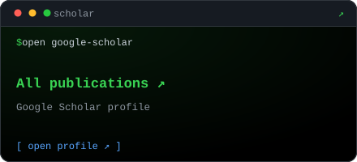
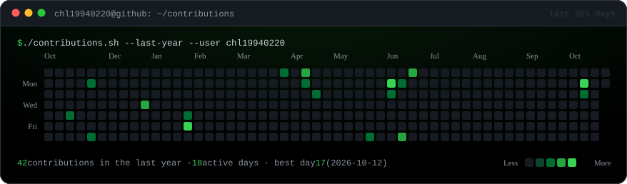

<!-- ============================================================================
     GitHub Profile README - academic edition, black-terminal theme
     ----------------------------------------------------------------------------
     LANGUAGE SWITCH
       English is expanded by default, 中文 lives in the second 
 block.
       GitHub strips JavaScript and CSS from READMEs, so 
/

       is the only reliable way to build a language toggle: click a badge.
     STRUCTURE
       prose sections (whoami / research / publications / news) are duplicated in
       both languages. The dashboard sections (projects / stats / contributions /
       stack) live once, below the toggle, with bilingual captions - every extra
       copy costs another request to a third-party card service, and those
       services rate-limit aggressively.
     PLACEHOLDERS
       Every {{PLACEHOLDER}} must be replaced before publishing.
       Full checklist + service list + config steps: PROFILE_SETUP.md
     ASSETS
       assets/banner.svg                 hero banner
       assets/cards/paper-*.svg          publication cards (edit text in the SVG)
       assets/cards/more-papers.svg      "all publications" card
       assets/contribution-graph.svg     regenerated daily by contributions.yml
     NOTE
       Inline code uses <code>...</code> rather than backticks so the file stays
       trivially greppable and sed-able. Both render identically on GitHub.
     ============================================================================ -->

  

<!-- shared contact row: language-neutral, so it is not duplicated -->

  
  
  
  
  

Language / 语言 &mdash; click a badge to expand or collapse

<!-- ============================ ENGLISH (default) ============================ -->

## <code>$ whoami</code>

> **PhD Candidate** &middot; Nanjing University
> Research focus: **AI Agent** &middot; Software Engineering

&nbsp;&nbsp;&#9656; **About** &mdash; {{BIO_EN}}
&nbsp;&nbsp;&#9656; **Based in** &mdash; NanJing, China
&nbsp;&nbsp;&#9656; **Status** &mdash; &#128188; **Open to work**

---

## <code>$ tree research/ -L 2</code>

<pre>
research/
├── AI Agent/                    # AI Agent
│   ├── {{RESEARCH_TOPIC_1}}
│   └── {{RESEARCH_TOPIC_2}}
├── Software Engineering/
    └── {{RESEARCH_TOPIC_3}}
</pre>

---

## <code>$ ls -lt publications/</code>

<!-- card text limits: title <= 42 chars per line, authors <= 52, venue line <= 50 -->

  
  

---

## <code>$ tail -n 3 news.log</code>

- **[{{NEWS_1_DATE}}]** {{NEWS_1_EN}}
- **[{{NEWS_2_DATE}}]** {{NEWS_2_EN}}
- **[{{NEWS_3_DATE}}]** {{NEWS_3_EN}}

<!-- ============================ 中文（默认折叠） ============================ -->

## <code>$ whoami</code>

> **博士研究生（PhD Candidate）** &middot; Nanjing University {{LAB_NAME}}
> 研究方向：**AI Agent** &middot; Software Engineering

&nbsp;&nbsp;&#9656; **简介** &mdash; {{BIO_ZH}}
&nbsp;&nbsp;&#9656; **所在地** &mdash; NanJing, China
&nbsp;&nbsp;&#9656; **状态** &mdash; &#128188; **正在找工作**

---

## <code>$ tree research/ -L 2</code>

<pre>
research/
├── AI Agent/                    # AI Agent
│   ├── {{RESEARCH_TOPIC_1}}
│   └── {{RESEARCH_TOPIC_2}}
├── Software Engineering/
│   └── {{RESEARCH_TOPIC_3}}
└── {{RESEARCH_AREA_3}}/
    └── {{RESEARCH_TOPIC_4}}
</pre>

---

## <code>$ ls -lt publications/</code>

  
  

  

---

## <code>$ tail -n 3 news.log</code>

- **[{{NEWS_1_DATE}}]** {{NEWS_1_ZH}}
- **[{{NEWS_2_DATE}}]** {{NEWS_2_ZH}}
- **[{{NEWS_3_DATE}}]** {{NEWS_3_ZH}}

<!-- ================= dashboard sections (shared, bilingual) ================= -->

---

## <code>$ ls projects/</code>

Selected projects &middot; 主要项目

  
  

  
  

---

## <code>$ ./stats.sh --github</code>

Live GitHub statistics &middot; GitHub 实时统计

  
  

---

## <code>$ ./contributions.sh --last-year</code>

Rolling 365-day contribution graph &middot; 近一年贡献图

  

Rendered locally and refreshed daily by <a href=".github/workflows/contributions.yml">contributions.yml</a> &mdash; 由 GitHub Actions 每日自动更新，不依赖第三方卡片服务。

---

## <code>$ cat stack.txt</code>

Languages and tools &middot; 常用语言与工具

  
  
  
  
  
  
  

<!-- add more with this pattern (slug list: https://simpleicons.org):
      -->

---

<code>$ exit 0</code> &middot; black-terminal profile kit &middot; <a href="#top">back to top</a>

